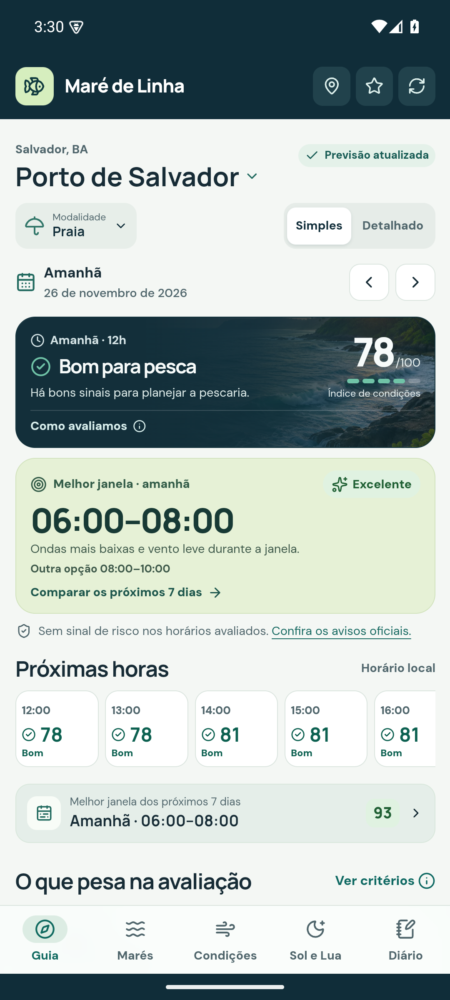

# Maré de Linha

Guia de pesca gratuito para Android, em português. Veja a melhor janela prevista, compare os próximos sete dias e entenda o que vento, ondas, maré e chuva significam para a sua modalidade. O app funciona sem conta, anúncios ou assinatura.

**[Conhecer o aplicativo](https://joaomarcosprog.github.io/mare-de-linha/)** · **[Baixar APK 2.0.0](https://github.com/joaomarcosprog/mare-de-linha/releases/download/v2.0.0/Mare-de-Linha-2.0.0.apk)** · [Ver releases](https://github.com/joaomarcosprog/mare-de-linha/releases)



## O que você encontra

- **Guia e planejamento.** Índice de condições de 0 a 100, melhores janelas, fatores favoráveis e pontos de atenção. O índice ajuda a planejar a pescaria. A chance de captura depende da espécie, da técnica e do ponto.
- **Sete modalidades.** Praia, alto-mar, costão e pedras, rio, manguezal, estuário e pesca embarcada. Os pesos mudam de acordo com a modalidade.
- **Duas formas de leitura.** O modo Simples explica as condições em linguagem direta. O modo Detalhado reúne medidas, gráficos e tabelas de maré, tempo, mar, Sol e Lua.
- **Pontos e diário.** Busque por cidade, GPS ou coordenadas e salve seus locais. Favoritos, capturas, cálculos astronômicos e tábuas incluídas ficam disponíveis offline. O app também mantém previsões consultadas recentemente.

## Instalar no Android

1. Baixe `Mare-de-Linha-2.0.0.apk` na [release v2.0.0](https://github.com/joaomarcosprog/mare-de-linha/releases/tag/v2.0.0).
2. Abra o APK no Android 7.0 ou superior com o WebView atualizado. Se o sistema solicitar, permita a instalação pelo app que você usou para abrir o arquivo.
3. Se já usa o Maré de Linha 1.0, instale a atualização por cima para manter o diário e os favoritos.

## Dados e cobertura

| Informação | Fonte e cobertura |
| --- | --- |
| Tempo, ondas, correntes e temperatura da água | Previsão de até sete dias. [Open-Meteo](https://open-meteo.com/en/docs/) · [API marítima](https://open-meteo.com/en/docs/marine-weather-api) |
| Maré oficial | Tábuas de 2026 incluídas para Salvador, Aratu, Madre de Deus, Ilhéus e Recife. Outros pontos usam estimativas oceânicas quando disponíveis. [CHM / Marinha do Brasil](https://www.marinha.mil.br/chm/tabuas-de-mare-6) |
| Rio | Vazão diária regional do maior rio próximo no modelo GloFAS. [Open-Meteo](https://open-meteo.com/en/docs/flood-api) |
| Sol, Lua e solunar | Cálculo local. O sinal solunar tem peso pequeno no índice e seu efeito varia por espécie e local. [Astronomy Engine](https://github.com/cosinekitty/astronomy) |

Os alertas do app destacam sinais da previsão para a modalidade. Antes de navegar, confira as condições do ponto, as tábuas da estação e os avisos oficiais. [Avisos de mau tempo da Marinha](https://www.marinha.mil.br/chm/dados-do-smm-avisos-de-mau-tempo/avisos-de-mau-tempo)

As consultas online usam a API gratuita do Open-Meteo para uso não comercial. As coordenadas consultadas são enviadas ao serviço. O GPS é opcional e os favoritos e capturas ficam no aparelho. [Condições de uso do Open-Meteo](https://open-meteo.com/en/terms)

## Desenvolvimento

O aplicativo usa Java no Android e tem interface empacotada em HTML, CSS e JavaScript. O índice fica em `src/guide.js`, as interpretações em `src/insights.js` e a página pública em `docs/`. [Análise de UI/UX da versão 2.0](docs/analise-ui-ux.md)

Use Node.js e JDK 17. Para compilar no Windows com PowerShell 7, instale a plataforma `android-35` e as build tools `35.0.0` no SDK do Android.

```powershell
npm ci
node test-guide.mjs
./build-android.ps1 -SdkPath 'C:/caminho/android-sdk' -JavaPath 'C:/caminho/jdk-17' -OutputApk './Mare-de-Linha.apk'
```

O script cria uma chave local na primeira compilação. Guarde-a para assinar suas próprias atualizações. O APK publicado usa a chave original do Maré de Linha. [Documentação de desenvolvimento](docs/desenvolvimento.md)

Encontrou algum problema? Informe a versão do app, o modelo do celular e os passos para reproduzir. [Abrir issue](https://github.com/joaomarcosprog/mare-de-linha/issues/new/choose)
